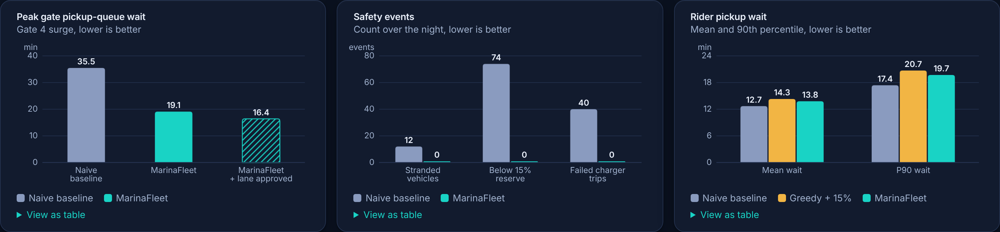

<p align="center"></p>

# MarinaFleet: Autonomous Event Mobility & EV Robotaxi Orchestration Agent

**Clear the stadium. Protect every battery.**

*Domain 2: Smart City & Autonomous Mobility, University Track*

Sixty thousand fans leave Marina City Stadium at once. MarinaFleet is a **hybrid agentic orchestrator**:
an LLM agent interprets the situation and decides *what* to do, deterministic Python does **all** the
battery maths, optimisation, safety checks and execution, and a **human operator** must approve any
physical lane or signal change.



---

## 1. Quick start (offline, no API key)

```bash
cd MarinaFleet
python -m venv .venv && source .venv/bin/activate      # Windows: .venv\Scripts\activate
pip install -r requirements.txt
python data/generate_data.py        # optional: the dataset is already included; regenerates it identically (seed 42)
python -m pytest -q                 # 110 tests
python run_scenario.py --decision approve   # headless full run (Mock LLM)
streamlit run app.py                # operator UI → http://localhost:8501
```

Sign in on the start page:

| Role | Login | What you get |
|---|---|---|
| **Operator / Admin** | `admin` / `MarinaOps!2026` (set `MARINA_ADMIN_PASSWORD` to change) | Operations console: run the agent, Agent-vs-Code trace, approvals, ROI, audit, rider bookings |
| **Rider** | `rider@demo.ae` / `RideDemo!2026`, or create an account | Book a battery-checked robotaxi, see the fastest pickup gate, manage trips |

In the console press **Run event-night scenario**, then work through the KPI strip, the operations map, the Agent-vs-Code trace
and the tabs (see `docs/demo_script.md`).

## 2. Switching LLM backends

Pick the backend in the Streamlit sidebar, or set `MARINA_LLM_BACKEND` in `.env` (copy `.env.example`).

| Backend | Setup | Env vars |
|---|---|---|
| **Mock** (default) | none, fully offline and deterministic | — |
| **Ollama** (local qwen3) | install Ollama, then `ollama pull qwen3:8b` and `ollama serve` | `OLLAMA_HOST`, `OLLAMA_MODEL` |
| **Gemini Flash** | free key from Google AI Studio | `GEMINI_API_KEY`, `GEMINI_MODEL` |
| **Groq** | free key from console.groq.com | `GROQ_API_KEY`, `GROQ_MODEL` |

```bash
python run_scenario.py --backend ollama
GEMINI_API_KEY=... python run_scenario.py --backend gemini
```

If a backend has no key, or its server is unreachable, the run **falls back to the Mock LLM** and says so
(`MARINA_LLM_FALLBACK_TO_MOCK=true`). Keys are only ever read from environment variables.

All backends use the same protocol: **structured JSON actions** (`{"tool", "arguments", "rationale"}`),
requested in each vendor's JSON mode. This keeps the agent loop identical for every model, including
models without native tool calling.

## 3. Project layout

```
MarinaFleet/
  app.py                  Streamlit entry point: page config, styles, routes to login / rider portal / operator console
  ui/                     the whole visual layer (no safety logic)
    theme.py              every design token as a constant, plus CSS-variable and chart-template generators
    styles.css            all styling, via var(--mf-*) only; injected once
    components.py         brand_header, kpi_card, status_pill, section_title, callout, timeline_item, map, panels
    charts.py             brand SVG charts (grouped bars, single bars, hbar) with table fallback
    icons.py              the single icon set (52 outline icons)
    brand.py              logo, favicon and asset generator (python -m ui.brand)
    viewmodel.py          display-only data prepared from run results (KPIs, trace, map layout)
    login.py · rider.py · admin.py   the three screens
  assets/                 logo.svg · logo-mark.svg · favicon.svg · favicon.png
  .streamlit/config.toml  matching dark theme
  tools/                  preview_harness.py · make_screenshots.py (offline rendering, developer use only)
  run_scenario.py         headless CLI run (same pipeline as the UI)
  config.py               settings + safety constants (15% reserve is a fixed constant)
  data/                   generate_data.py, marina_stadium_egress.sqlite, csv/ exports
  services/               snapshot.py · optimizer.py · dispatch.py   (the 3 mock services) · booking.py (rider portal)
  engine/                 battery_math.py · guards.py · approval_gate.py · audit.py · auth.py · ops_db.py · road_network.py
  agent/                  llm_client.py (Mock/Ollama/Gemini/Groq) · agent_loop.py · prompts.py
  tests/                  pytest suite (+ a Streamlit stub for the UI smoke test)
  docs/                   architecture.md (Mermaid) · demo_script.md · slide_summary.md · BRAND_GUIDE.md · roi_chart.png · screenshots/
  runtime/                created at run time: marina_ops.sqlite (audit/approvals/orders) + audit_log.jsonl
```

## 3b. Brand and interface

The interface is one continuous brand from sign-in to the last tab: a dark operator-console look with a teal
brand colour, a sand-gold accent for operator approval, and semantic safe / warning / danger colours that always
come with an icon and a text label. See **`docs/BRAND_GUIDE.md`** for the logo, palette, type scale, components and voice.

- **One source of truth.** `ui/theme.py` holds the tokens; `ui/styles.css` and the Python HTML/SVG read them.
  `tests/test_ui_design.py` fails if a hex colour, raw font size, raw radius or inline style appears elsewhere,
  and it checks WCAG AA contrast for every text pair.
- **Console layout.** Top bar (logo, tagline, event clock, system status, LLM backend) · sidebar (scenario controls)
  · KPI strip · operations map (gates 1 to 6, Gate 4 surge ring, fleet and charger markers) · live Agent-vs-Code trace
  with **AGENT** (teal), **CODE** (gold) and **BLOCKED BY GUARD** (red) badges · tabs: Dispatch Decisions, Charger Network,
  Approval Queue, Audit Log, ROI vs Baseline, plus Feeder & Metro, Bookings and Report.
- **Key moments.** Gate 4 surge banner; a charger card showing telemetry age against the threshold with the line
  "Routing blocked by code, not by the LLM."; a per-vehicle battery bar with a red 15% floor line; a gold operator-approval
  panel; ROI charts in the brand palette with a table view.
- **No backend changes.** The redesign touched only the presentation layer; the safety rules, tool names and
  services are as before.

Screenshots are in `docs/screenshots/` (see "Verification of the interface" below for how they were made).

## 4. Architecture: who does what

| Agent (LLM) | Code (Python) |
|---|---|
| Reads the snapshot and recognises the Gate 4 surge | Computes surge ratio, queue waits and flags (`snapshot.py`) |
| Notices the stale/offline charger notices | Decides freshness: ONLINE + telemetry ≤ N min + free slot (`guards.py`) |
| Chooses the strategy (`surge_first_battery_safe` / `min_deadhead`) and priority gates | Hungarian assignment (SciPy `linear_sum_assignment`) on a battery-feasible cost matrix (`optimizer.py`) |
| Chooses which order types to execute, in which order | Builds payloads from plan IDs, re-validates every item, executes, writes orders (`dispatch.py`) |
| Requests a lane reallocation, with justification | Refuses without a token; approval state machine (`approval_gate.py`) |
| Writes the operator report and trade-off narrative | Appends a Python-generated KPI table; logs everything (`audit.py`) |

Diagrams: `docs/architecture.md`.

**Loop:** snapshot → analysis → optimizer → validation → autonomous dispatch / charger orders →
approval request for lane change → audit log → operator report → (human) approve / reject.

## 5. Safety design (enforced in code, never by the LLM)

1. **No LLM maths.** The model only returns a tool name, strategy, gate IDs and order types. Vehicle and
   charger IDs come from the optimiser's plan, and `dispatch.py` recomputes every number from the snapshot.
   A tampered payload (e.g. `"soc_at_charger_pct": 99`) is ignored, and the trip is blocked if it is unsafe.
2. **15% reserve.** SoC after **pickup leg + trip leg + drive to the nearest *verified* charger** must be
   ≥ 15% (`guards.battery_reserve_guard`). It is checked three times: in the optimiser's feasibility mask,
   in a scalar re-check of every chosen pair, and again at dispatch. If no verified charger exists,
   nothing is dispatched (fail-safe).
3. **Telemetry freshness.** Chargers that are OFFLINE, stale (> `MARINA_STALE_MINUTES`, default 5), have a
   future timestamp, or report no slots are refused, with a code-generated reason. Low-battery cars are
   rerouted to verified hubs. Cars that cannot reach any verified hub with ≥ 5% stay parked and get a
   mobile-charger request. Slot over-booking is prevented.
4. **Human approval for physical changes.** `PICKUP_ZONE_LANE_REALLOCATION`, `LANE_REVERSAL` and
   `SIGNAL_PRIORITY_OVERRIDE` follow `PENDING_APPROVAL → APPROVED → EXECUTED` or `→ REJECTED`. Approval
   issues a random one-time token; only its SHA-256 hash is stored. The token is bound to one request and
   one action type and works once. Autonomous order types whose payload carries lane/signal keys are
   escalated to the gate too.
5. **Autonomous actions:** ride dispatch, rebalancing, verified charger reservations, buses, metro
   announcements, rider guidance, mobile-charger requests.

Every step is written to `runtime/marina_ops.sqlite` (`audit_log`) and mirrored to
`runtime/audit_log.jsonl`. Each record holds: timestamp, run_id, actor (AGENT_LLM / CODE_PYTHON /
HUMAN_OPERATOR), tool, inputs, outputs, guard results, rationale, and execution mode (AUTONOMOUS /
HUMAN_APPROVED / PENDING_APPROVAL / BLOCKED / REJECTED).

## 5b. Accounts and the rider portal

- **Accounts** (`engine/auth.py`): stored in the ops DB `users` table as salted PBKDF2-HMAC-SHA256 hashes. There are two
  roles, rider and admin, and each sign-in form accepts only its own role. Five failed attempts lock the account
  for 5 minutes. Approval decisions call `require_role(user, "admin")` and record the operator's name.
- **Booking** (`services/booking.py`): a rider booking is just another ride request, so no LLM is involved. Python picks
  the fastest idle car that passes the **same 15% guard** (pickup + trip + leg to a verified charger). Estimated pickup
  is max(car ETA, curb-queue wait at that gate). If a neighbouring gate about 200 m away is at least 5 min faster, the
  portal suggests walking there. Confirming goes through `dispatch_fleet_or_charger_order(RIDE_DISPATCH)`, which
  re-validates the trip, so forged quote numbers are ignored. Booked cars are excluded from later quotes. Fares use
  an illustrative demo tariff (AED 12 + 2.10/km, minimum AED 20).
- This is prototype-grade auth: there is no password reset, MFA or HTTPS termination. Put it behind a real identity
  provider before any real use.

## 6. Synthetic dataset (seed 42)

`data/generate_data.py` writes `marina_stadium_egress.sqlite` and one CSV per table:
6 gates (Gate 4 surge: 9,800 fans, 2.8× expected), 800 robotaxis (SoC, node, status, seats, kWh/km,
battery size), 40 feeder buses, 2 metro stations (capacity, headway, load), 7 chargers
(**CH_JBR stale**: 23-min-old cached data; **CH_MEDIA offline**), charger notices, crowd events,
380 pending ride requests, and a 33-node road graph with an all-pairs distance matrix.
Coordinates are a local km grid, not real map data.

## 7. Stretch goals

- **A. ROI comparator:** naive nearest-car (no battery awareness, trusts cached chargers) vs
  greedy + 15% vs MarinaFleet, shown in the UI charts and in `docs/roi_chart.png`.
- **B. Multi-modal balancer:** forecasts 30-min overflow per gate and deploys available buses (nearest
  first, 60% of overflow). The rest goes to metro announcements, routed by spare capacity.
- **C. Rider guidance:** balances the surge gate with its ~200 m neighbours and pushes walking nudges
  with before/after ETAs.
- **D. Weather adapter:** rain/fog change speed (ETAs, curb throughput) and energy use (battery margins).

### Results on the included scenario (clear weather)

| Metric | Naive | Greedy + 15% | **MarinaFleet** |
|---|---|---|---|
| Mean rider pickup wait (min) | 12.7 | 14.3 | **13.8** |
| P90 rider pickup wait (min) | 17.4 | 20.7 | **19.7** |
| Pickup deadhead (km) | 1758.5 | 2174.3 | **2073.2** |
| Wasted km to dead/stale hubs | 107.4 | – | **0** |
| Stranded vehicles | 12 | 0 | **0** |
| Dispatches below 15% reserve | 74 | 0 | **0** |
| Failed charger attempts | 40 | – | **0** |
| Peak gate pickup-queue wait (min) | 35.5 | – | **19.1** (16.4 if lane approved) |

**Read this honestly.** The naive baseline has a slightly lower mean pickup time and fewer empty km
because it uses nearby low-battery cars, and those cars then strand or drop below reserve. The fair
comparison for the optimiser is "Greedy + 15%" (same safety rules), which it beats on mean wait, P90 wait
and deadhead. The big win on the crowd side is the gate queue (rider guidance + buses + optional lane).

## 8. Modelling assumptions & limitations

- Pickup wait = drive time at 32 km/h × weather factor + a gate-approach congestion delay. Gate queue wait
  = ride-hail parties ÷ curb throughput (a simple queue model, not a microsimulation).
- Energy is linear in distance (kWh/km × weather factor); there is no elevation, HVAC or speed curve.
- One optimisation cycle on one snapshot. The 30-min multi-modal forecast uses a fixed 35% return rate
  for busy vehicles.
- The naive baseline assumes the stale JBR hub is actually full on arrival (the scenario premise).
- "Executing" an order means writing it to the orders table. There is no real vehicle or signal API.
- Rider bookings are quoted against the scenario snapshot; they do not move vehicles over time.

## 8b. Verification of the interface

What was run: the full pytest suite (110 tests, including the UI smoke tests that execute the real page code against a
Streamlit stub, and the design-system tests), the headless scenario (`python run_scenario.py --decision approve` and
`--decision reject`), and an offline render of every screen to PNG.

What the screenshots are: `tools/preview_harness.py` runs the real page code with a stand-in for Streamlit, serialises the
output to static HTML with the real `styles.css`, and Chromium (Playwright) captures it at 1366 x 768. This is an
**approximation** of Streamlit: native widgets (buttons, tabs, inputs) are drawn by the harness, and the sandbox had no
access to Google Fonts, so system fallback fonts appear in the images. Regenerate with `python tools/make_screenshots.py`.

What was **not** verified: the app has not been run inside a real Streamlit server in this build environment, so the
following are untested there: the `:has()`-based gold approval panel, the CSS selectors that restyle Streamlit's own tabs,
buttons, selectboxes, expanders and dataframes (they depend on Streamlit's internal markup, which can change between
versions), the favicon in a real browser tab, the loading state as a live animation, hover and focus states, and
`prefers-reduced-motion` behaviour. The loader is an indeterminate animation, not live progress.

## 9. Viva cheat-sheet

- *Why Hungarian?* It gives the globally optimal one-to-one vehicle↔request matching in polynomial time.
  Infeasible pairs get a huge cost and are dropped afterwards. A small quadratic wait term lowers P90.
- *Why re-validate at dispatch?* Defence in depth: the executor must not trust its caller, whether that
  is an LLM, the UI or the optimiser.
- *Why a token rather than a flag?* A flag can be set by anyone holding the payload. A one-time token
  exists only after a recorded human decision, and is bound to one request and one action.
- *Why JSON actions instead of native tool calling?* It is one protocol for four backends, it works with
  models that lack tool calling, and parsing errors are caught and fed back by code.
