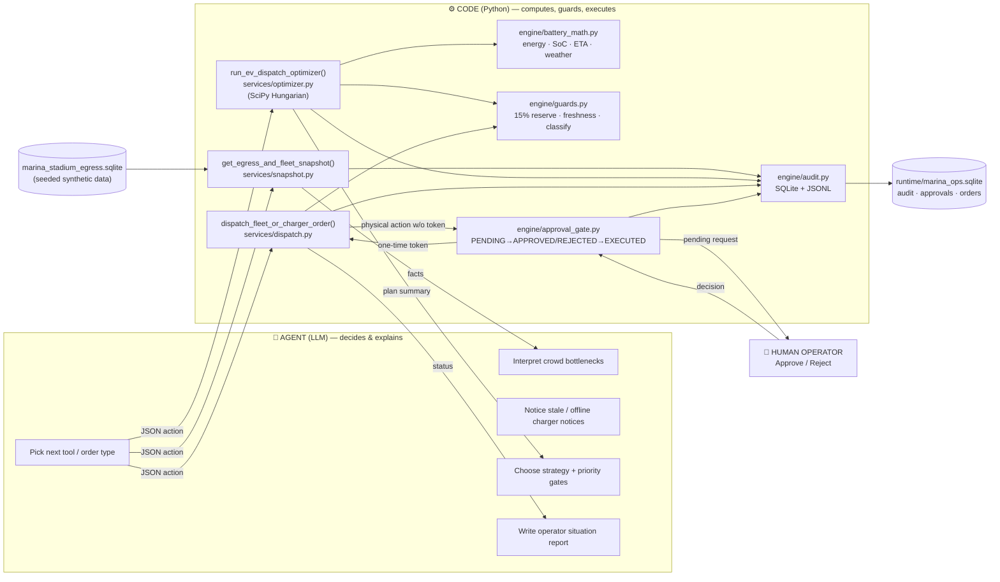

# MarinaFleet architecture

## Agent vs Code separation



## Agent loop (one event-night cycle)

```mermaid
sequenceDiagram
    participant LLM as Agent (LLM)
    participant Loop as agent_loop.py
    participant Py as Python services + guards
    participant Op as Human operator
    Loop->>LLM: system prompt + task
    LLM-->>Loop: {"tool":"get_egress_and_fleet_snapshot"}
    Loop->>Py: snapshot (surge flags, charger verdicts computed in code)
    Py-->>LLM: OBSERVATION (Gate 4 SURGE, CH_JBR STALE, CH_MEDIA OFFLINE)
    LLM-->>Loop: run_ev_dispatch_optimizer(priority_gates=[G4])
    Loop->>Py: Hungarian assignment + 15% guard + charger routing + rebalancing + buses/metro + guidance
    Py-->>LLM: OBSERVATION (counts, KPIs, refusals, lane proposal)
    loop autonomous orders
        LLM-->>Loop: dispatch(RIDE_DISPATCH / CHARGER_RESERVATION / REBALANCE / ...)
        Loop->>Py: re-validate every item, execute, audit
    end
    LLM-->>Loop: dispatch(PICKUP_ZONE_LANE_REALLOCATION, G4)
    Loop->>Py: no token → REFUSED, request PENDING_APPROVAL
    LLM-->>Loop: finish(report)
    Op->>Py: Approve → token → EXECUTED (HUMAN_APPROVED)  /  Reject → REJECTED
```

## Safety rules → where they are enforced

| Rule | Enforced in | Tested in |
|---|---|---|
| 1. LLM never computes numbers | LLM only returns tool/strategy/order type; payloads built from plan IDs by code (`agent_loop._payload_for`) and recomputed in `dispatch.py` | `test_dispatch_revalidates_and_blocks_tampered_assignment` |
| 2. 15% reserve after pickup + trip + charger leg | `guards.battery_reserve_guard`, optimiser feasibility mask, dispatch re-check | `test_reserve_boundary_*`, `test_optimizer_never_unsafe`, randomised fleets |
| 3. Stale (>N min) / offline chargers rejected | `guards.charger_freshness_guard` in snapshot, optimiser and dispatch | `test_stale_*`, `test_offline_*`, `test_no_charger_orders_to_stale_or_offline` |
| 4. Physical lane/signal changes need human approval | `approval_gate.py` state machine + token check in `dispatch.py` | `test_approval_gate.py`, `test_llm_cannot_execute_physical_action_directly` |
| 5. Rebalancing & valid charger reservations autonomous | `guards.AUTONOMOUS_ACTIONS` | `test_end_to_end_workflow` |
